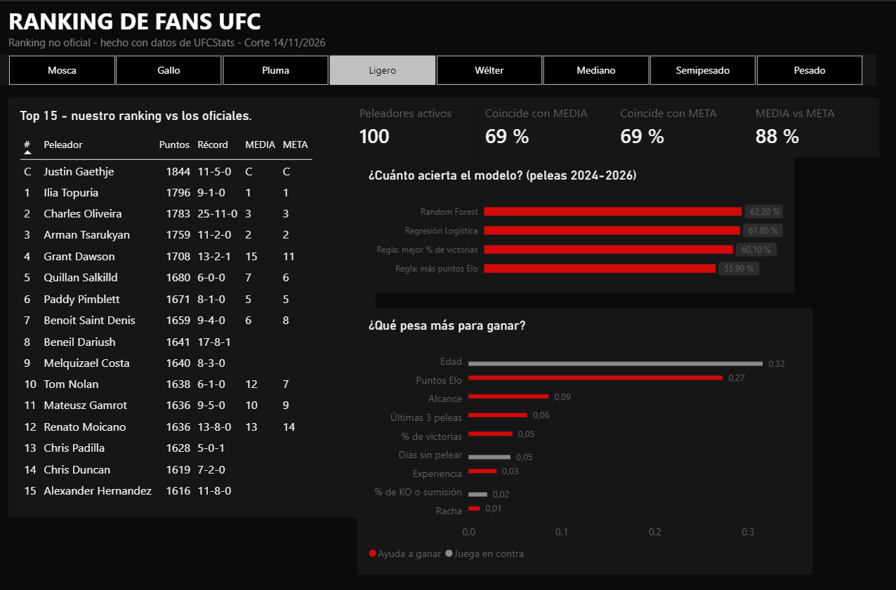

# Ranking de Fans UFC 🥊

**Ciencia de Datos (INA) · Proyecto final individual · Noviembre–Diciembre 2026**

Un **tercer ranking** de la UFC para las 8 categorías masculinas, hecho con datos públicos y
explicable pelea por pelea, más un **modelo de machine learning** que lo pone a prueba.

## ▶ Para abrir la app

**Online (sin instalar nada):** https://ranking-fans-ufc.streamlit.app/

**En la PC:**

1. En VS Code: **Archivo → Abrir carpeta…** → elegir la carpeta **`ufc_ranking`**.
2. Abrir `app.py` y apretar **▷ (Run Python File)** o **F5**.

La primera vez instala sola las librerías que falten y después abre el navegador en
`http://localhost:8501`. Solo hace falta tener Python instalado. Para cerrarla: `Ctrl + C` en la terminal.

---

## 1. La pregunta de negocio

¿Un ranking hecho con datos y una fórmula pública llega a las mismas conclusiones que los rankings oficiales?

| Ranking | ¿Quién lo hace? | ¿Se puede explicar? |
|---|---|---|
| MEDIA (oficial) | Un panel de periodistas que vota | No: es opinión |
| META (oficial) | La UFC con inteligencia artificial | No: es una caja negra |
| **De fans (este proyecto)** | **Una fórmula con datos de UFCStats** | **Sí: cada puesto se explica pelea por pelea** |

**Organización:** "Esquina Roja", tres fans que ven todos los eventos. **Usuario final:** mi hermano.

## 2. Etapa 1 · Diagnóstico y propuesta

- **Datos:** UFCStats.com (estadísticas oficiales de la UFC), vía el repositorio público
  [Greco1899/scrape_ufc_stats](https://github.com/Greco1899/scrape_ufc_stats).
  797 eventos y 9.028 peleas, desde 1994. **Fecha de corte: 14/11/2026 (UFC 334).**
- **Diagnóstico (EDA):** 7 problemas de calidad. Los dos más graves dan resultados falsos sin avisar:
  25 peleas duplicadas por eventos renombrados y 9 homónimos sin código único (ej. dos "Bruno Silva").
- **Prioridad:** primero limpiar los datos, después construir el ranking.

## 3. Etapa 2 · Solución

### Opción A · Ranking Elo (el que se usa)

"Ganás y sumás puntos; si le ganás a alguien mejor, sumás más." Todos arrancan con 1500 puntos;
K = 48; +25% por KO o sumisión; las peleas por el título valen doble. Se calcula desde 2010
(arrancar en 1994 da el mismo ranking). Solo aparecen los activos (última pelea en los últimos
18 meses), sin los retirados anunciados, y el campeón va aparte, como en el oficial.

**Resultado vs. oficiales** (campeón + top 15): el campeón coincide en las 8 categorías;
el top coincide un **75% con el MEDIA** y un **79% con el META** (los dos oficiales coinciden
entre sí un 86%).

### Opción B · Modelo de machine learning (sustento de A)

- **Qué hace:** predice quién gana una pelea (aprendizaje supervisado, clasificación binaria).
- **Datos:** 6.098 peleas con ganador (2012–2026) y 9 variables previas a la pelea, como diferencia
  entre los dos peleadores: puntos Elo, experiencia, % de victorias, % de finishes, racha,
  últimas 3, días sin pelear, edad y alcance.
- **Sin fuga de datos:** el orden de los peleadores se sortea (en la base, el primero gana el 57%)
  y se entrena con 2012–2023 para probar con 2024–2026.
- **Evaluación y comparación** ([`etapa2_solucion/02_modelo_predictivo.ipynb`](etapa2_solucion/02_modelo_predictivo.ipynb)):
  Regresión Logística vs. Random Forest, con validación cruzada temporal, accuracy, precision, recall, F1, AUC,
  matrices de confusión y curva ROC.
- **Resultados (2024–2026):** Regresión Logística 61,8% · Random Forest 62,2% · regla "gana el de más Elo" 55,9%.
- **Por qué Regresión Logística:** rinde prácticamente igual que el Random Forest (0,4 puntos, unas 5 peleas de
  1.292), da una probabilidad y se explica variable por variable (caja blanca).
- **Conclusión:** los puntos Elo son, junto con la edad, lo que más pesa. El ranking mide algo real.

### Tablero de Power BI

Una sola hoja: top 15 de cada categoría con los puestos de MEDIA y META al lado, cuánto coincide con los
oficiales y los resultados del modelo. Archivo: **[`powerbi/Tablero del Ranking.pbix`](powerbi/Tablero%20del%20Ranking.pbix)**
(se abre con Power BI Desktop, gratis). Guía de armado: [`powerbi/powerbi_paso_a_paso.md`](powerbi/powerbi_paso_a_paso.md).



Se entrega como `.pbix` en el repositorio, por indicación del profesor: "Publicar en la web" está deshabilitado
en la cuenta del INA por seguridad.

### La app (Streamlit)

Ranking por categoría con los oficiales al lado · ficha de cada peleador con su historial de puntos ·
"¿Quién gana?" (modelo) · comparación con los oficiales · cómo funciona.

## 4. Estructura

```
ufc_ranking/
├── app.py                  ← la app (se abre sola con ▷ o F5)
├── .streamlit/config.toml  ← colores de la app
├── requirements.txt        ← librerías
├── data/
│   ├── raw/                ← datos de UFCStats tal cual llegan
│   ├── processed/          ← datos limpios, ranking y modelo
│   └── external/           ← rankings oficiales (capturas del 16/11/2026) y retirados anunciados
├── src/
│   ├── descargar_datos.py  ← baja los datos
│   ├── limpieza.py         ← limpia y arma las tablas
│   ├── elo.py              ← ranking Elo (opción A)
│   ├── controles_elo.py    ← controles del ranking
│   ├── rfm.py · comparar_elo_rfm.py   ← antecedente (primera opción B)
│   ├── comparar_oficial.py ← comparación con MEDIA y META
│   └── modelo.py           ← modelo de machine learning (opción B)
├── powerbi/                ← tablero (.pbix), captura, datos (Excel), tema, guía y preparar_powerbi.py
├── etapa1_diagnostico/01_EDA.ipynb    ← análisis exploratorio
├── etapa2_solucion/02_modelo_predictivo.ipynb ← evaluación: Regresión Logística vs. Random Forest
└── docs/bitacora.md        ← el proceso paso a paso
```

**Actualizar después de un evento:** correr los scripts de `src/` en el orden de la lista y después
`powerbi/preparar_powerbi.py`; abrir el `.pbix` y tocar **Actualizar**.

## 5. Decisiones principales

| Decisión | Por qué |
|---|---|
| Fuente: UFCStats vía GitHub | Oficial, completa, al día y reproducible |
| Ranking Elo en vez de machine learning | Tiene que poder explicarse pelea por pelea |
| Título ×2, K = 48 y campeón aparte | El campeón quedaba 3.º: el Elo no distinguía una pelea por el cinturón |
| No ajustar parámetros para copiar al oficial | El objetivo es una tercera opinión con argumentos propios |
| Retirados anunciados afuera, con fuente | Un retirado en el top le quita credibilidad al ranking |
| Categoría = la de la última pelea | Simple y verificable. Limitación conocida: Holloway, Usman y Pereira |
| Modelo con split temporal y orden sorteado | Evaluar como se usaría en la realidad, sin fuga de datos |

## 6. Limitaciones y pendientes

- **Limitaciones:** la categoría por última pelea, la lista de retirados armada a mano y un deporte
  muy impredecible (~62% de acierto).
- **Pendientes:** devolución del usuario (mi hermano) · ajustes
  según el feedback de la cátedra.

El proceso paso a paso y las decisiones están en **[`docs/bitacora.md`](docs/bitacora.md)**.
